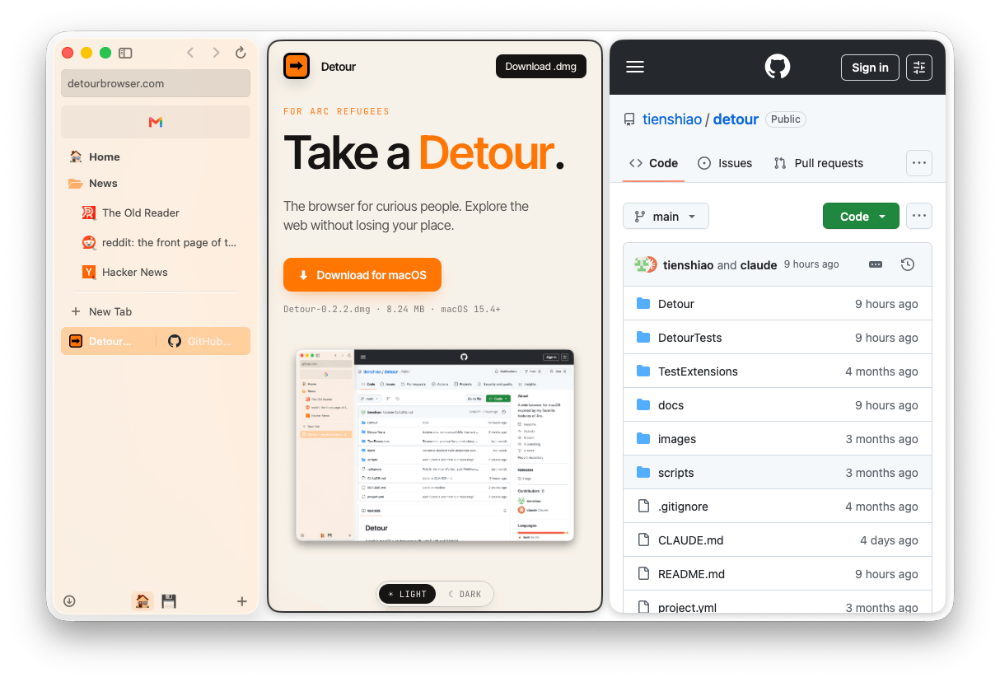

# Detour

A native macOS web browser built with Swift and WebKit, for people who keep a lot of the web open at once.

**[Download for macOS](https://detourbrowser.com)** · [Feature guide](https://detourbrowser.com/features/) · [Keyboard shortcuts](https://detourbrowser.com/shortcuts/) · [Releases](https://github.com/tienshiao/detour/releases)

<picture>
  <source media="(prefers-color-scheme: dark)" srcset="images/detour-split-dark.png">
  
</picture>

## Features

Each feature has a guide on [detourbrowser.com](https://detourbrowser.com/features/).

### Organize

- **[Spaces](https://detourbrowser.com/features/spaces/)**: workspaces in the sidebar, each with its own tabs, pinned tabs, emoji and color. Swipe between them.
- **[Profiles](https://detourbrowser.com/features/profiles/)**: separate logins, cookies, history and extensions, so you can be signed in to work and personal accounts on the same site at once. Each Space uses one Profile.
- **[Pinned tabs and folders](https://detourbrowser.com/features/pinned-tabs/)**: everyday sites at the top of each Space, in folders if you like. Closing a pinned tab keeps it; clicking it reopens the page you pinned.
- **[Favorites](https://detourbrowser.com/features/favorites/)**: the web apps you use all day at the top of the sidebar, shared by every Space on a Profile.
- **[Split Tabs](https://detourbrowser.com/features/split-tabs/)**: two pages side by side as one sidebar row. Drag a tab onto another or Option-click a link.
- **[Tab Archiving](https://detourbrowser.com/features/tab-archiving/)**: tabs you haven't looked at in 12 hours (or a time you choose per Profile) are archived and wait on the Archived Tabs page. A tab playing sound is never archived.

### Navigate

- **[Command Palette](https://detourbrowser.com/features/command-palette/)**: the address bar. ⌘T opens a page or search in a new tab, ⌘L changes this one. Open tabs, history and web suggestions in one list.
- **[Site Search](https://detourbrowser.com/features/site-search/)**: type a site's keyword, press Tab, and search that site.
- **[Peek](https://detourbrowser.com/features/peek/)**: preview a link in a panel over the page. Shift-click any link, or click a link to another site in a pinned tab. Close it, or keep it as a tab with ⌘O.
- **[Recent Tabs](https://detourbrowser.com/features/recent-tabs/)**: ⌃Tab flips between tabs in the order you used them, with previews; ⌥⌘↑/↓ follow the sidebar.
- **[Quick Detour](https://detourbrowser.com/features/quick-detour/)**: ⌥⌘N opens a small one-page browser window from any app. Move the page into a Space or close it.
- **[Link Routes](https://detourbrowser.com/features/link-routes/)**: send links to the right Space by site, address or the app they came from.
- **[History](https://detourbrowser.com/features/history/)**: a page per Profile, by day, with search and clearing.

### Privacy

- **[Quarantine](https://detourbrowser.com/features/quarantine/)**: open links from mail, chat and unknown senders in a throwaway window with none of your cookies and no history.
- **[Private Browsing](https://detourbrowser.com/features/private-browsing/)**: ⇧⌘N. No history; cookies and logins are kept in memory and cleared when the last Private window closes. Extensions stay off unless you allow them.
- **[Content Blocker](https://detourbrowser.com/features/content-blocker/)**: built-in ad, tracker and cookie-notice blocking with EasyList. Switch it off per site, or choose lists per Profile.
- **User agent**: each Profile can identify as Safari exactly; neither built-in setting sends your exact macOS version. See the [privacy setup guide](https://detourbrowser.com/features/privacy/).

### For developers

- **[Dev Mode](https://detourbrowser.com/features/dev-mode/)**: turns on by itself for localhost and `.test` sites, with a toolbar for the full URL, Console, Network, an element picker and full-page screenshots.
- **Web Inspector**: ⌥⌘I.

### Extensions

- **[Web Extensions](https://detourbrowser.com/features/web-extensions/)**: install extensions from the Chrome Web Store on WebKit. Each one is on per Profile, with toolbar popups, options pages and native messaging (1Password works). Some Chrome APIs are still missing; the guide lists what works.

### Everything else

- **Multiple windows**, each with its own active Space.
- **Session restore**: tabs come back after a relaunch with their scroll position and form state.
- **Downloads** with progress, reveal in Finder, and history across launches.
- **Audio**: tabs playing sound show a mute button.
- **Find in page** (⌘F), a link status bar, and a sidebar you can hide (⌘S).
- **Automatic updates** through Sparkle.

## Building

Requirements:

- macOS 15.4 or later to run; a current Xcode to build (releases are built with Xcode 27)
- [XcodeGen](https://github.com/yonaskolb/XcodeGen)

```bash
# Generate the Xcode project (again whenever files are added or removed)
xcodegen generate

# Build
xcodebuild -scheme Detour -configuration Debug build

# Run the tests
xcodebuild -scheme DetourTests -configuration Debug test
```

Or open `Detour.xcodeproj` in Xcode after running `xcodegen generate`.

The project signs with the maintainer's Developer ID team. To build without it, sign ad hoc:

```bash
xcodebuild -scheme Detour -configuration Debug CODE_SIGN_IDENTITY=- DEVELOPMENT_TEAM= build
```

A development build uses the same data folder as an installed Detour. To keep it separate, set `DETOUR_DATA_DIR` to another folder name when you launch it:

```bash
DETOUR_DATA_DIR=DetourDev path/to/Detour.app/Contents/MacOS/Detour
```

Architecture notes for contributors are in [CLAUDE.md](CLAUDE.md), and the project's accumulated knowledge (how subsystems work, WebKit quirks, decisions) is in [`wiki/`](wiki/index.md).

## Dependencies

- [GRDB.swift](https://github.com/groue/GRDB.swift): SQLite for the session and history databases
- [Sparkle](https://github.com/sparkle-project/Sparkle): automatic updates
